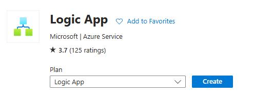
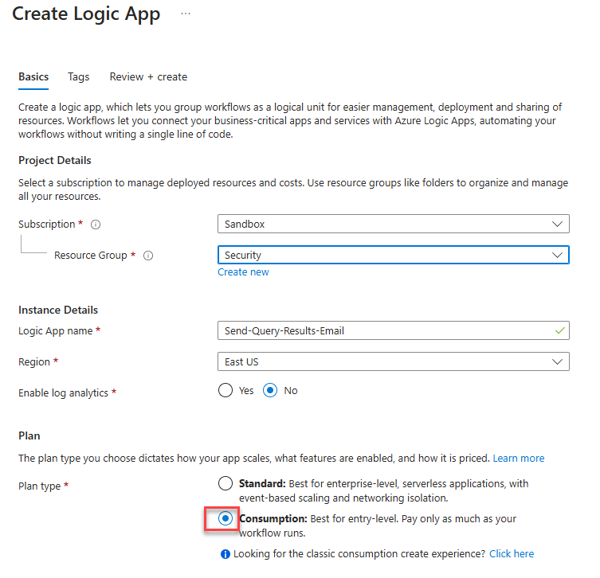
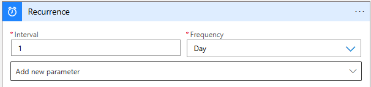
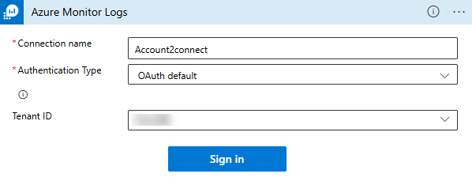
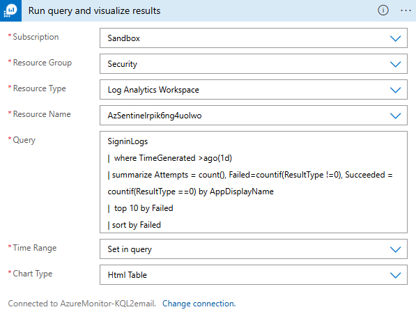
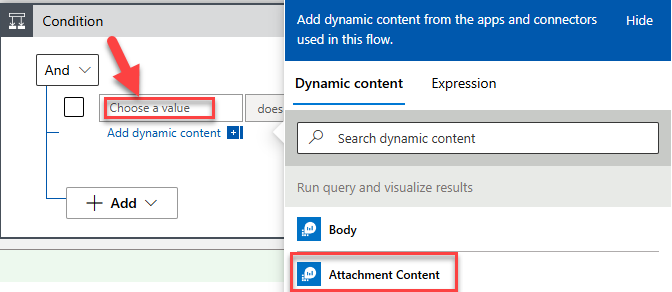
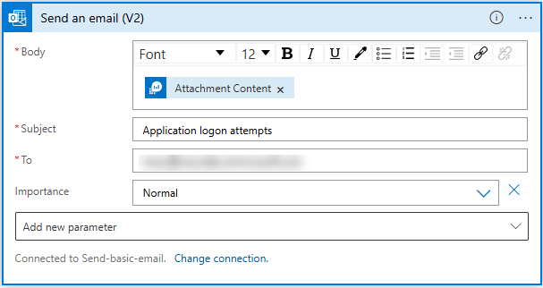
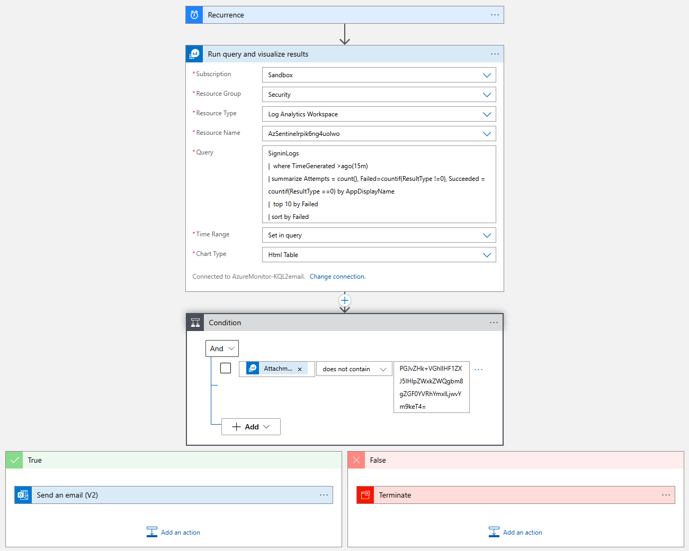
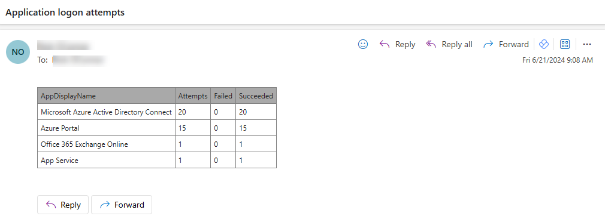
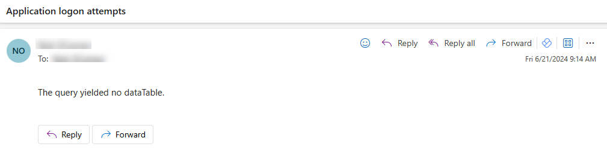

# Use a Logic App to send an email with Log Analytics workspace query results

This walkthrough shows how to create a logic app that sends an email when a query against a Log Analytics workspace returns results.

## Cited resources

- [Add conditions to control workflow actions in Azure Logic Apps](https://learn.microsoft.com/en-us/azure/logic-apps/logic-apps-control-flow-conditional-statement?tabs=consumption)
- [Create a Consumption logic app workflow](https://learn.microsoft.com/en-us/azure/logic-apps/tutorial-build-schedule-recurring-logic-app-workflow#create-a-consumption-logic-app-workflow)

## Assumptions

- A Log Analytics workspace exists and contains the tables and data required by your query.
- To use the example query, Microsoft Entra sign-in logs are routed to the workspace and the `SigninLogs` table contains data.
- The identity used by the Azure Monitor Logs connection has permission to query the workspace. For a managed identity, assign the **Log Analytics Reader** role at the workspace scope.
- The account used by the Office 365 Outlook connection has an Exchange Online mailbox.
- You have basic knowledge of how to create a logic app.

## Steps

### Create the logic app

- Sign in to the Azure portal and select **Create a resource**.
- Search for or navigate to **Logic App**, and then select **Create**.

  

- On the **Basics** tab, enter the subscription, resource group, logic app name, and region.
- For **Plan type**, select **Consumption**.

  

- Select **Review + create**.
- Select **Create**.

### Configure the logic app

#### Recurrence

- Open the logic app created in the previous step, and then select **Logic app designer** on the left.
- Select **Recurrence**.

  

- To check once per day for query results, set **Interval** to **1** and **Frequency** to **Day**.

#### Run query and visualize results

- Select **New step**.
- Search for **Run query and visualize results**.
- Select **Run query and visualize results** from the **Actions** tab.
- Enter a connection name, select an authentication type, enter the tenant ID, and then sign in.

  

- Enter the location information for your Log Analytics workspace.
- In **Query**, enter the KQL query that you want to use.

Example query:

```kql
SigninLogs
| where TimeGenerated > ago(1d)
| summarize Attempts = count(), Failed = countif(ResultType != 0), Succeeded = countif(ResultType == 0) by AppDisplayName
| top 10 by Failed
| sort by Failed
```

- For **Time Range**, select **Set in query** because the example query filters on `TimeGenerated`.
- For **Chart Type**, select **Html Table**.

  

#### Condition

- Select **New step**.
- Search for and select **Control**.
- Select **Condition**.
- In the condition, select the first **Choose a value** field, and then select **Attachment Content**.

  

- In the second field, select **does not contain**.
- In the last field, enter `PGJvZHk+VGhlIHF1ZXJ5IHlpZWxkZWQgbm8gZGF0YVRhYmxlLjwvYm9keT4=`.

> [!NOTE]
> If the query does not return any results, the output includes `PGJvZHk+VGhlIHF1ZXJ5IHlpZWxkZWQgbm8gZGF0YVRhYmxlLjwvYm9keT4=`. Decoding this Base64 string as ASCII produces `<body>The query yielded no dataTable.</body>`.

Use the following PowerShell code to decode the string:

```powershell
# Replace 'PGJvZHk+VGhlIHF1ZXJ5IHlpZWxkZWQgbm8gZGF0YVRhYmxlLjwvYm9keT4=' with your actual Base64 string
$base64String = 'PGJvZHk+VGhlIHF1ZXJ5IHlpZWxkZWQgbm8gZGF0YVRhYmxlLjwvYm9keT4='

# Decode the Base64 string to ASCII
$asciiString = [System.Text.Encoding]::ASCII.GetString([System.Convert]::FromBase64String($base64String))

# Print the result
Write-Host "Decoded ASCII string: $asciiString"
```

#### True

- Under **True**, select **Add an action**.
- Search for **Send an email (V2)**.
- Select **Send an email (V2)** from Office 365 Outlook.
- Sign in with the account whose mailbox you want to use to send the email.
- In **Body**, select **Attachment Content**.
- In **Subject**, enter a subject.
- In **To**, enter the email address that should receive the query results.

  

#### False

- Under **False**, select **Add an action**.
- Search for **Control**.
- Select **Terminate**.
- For **Status**, select **Cancelled**.



## Post condition

When a query runs and returns results, the condition is true and the user receives an email.



When a query runs and returns **no** results, the condition is false and the action terminates with a cancelled status.

If you receive an email without results that contains "The query yielded no dataTable," verify that you entered the condition correctly.



> [!NOTE]
> Once you have confirmed that everything is functioning correctly, consider changing the Azure Monitor Logs connection to use a system-assigned or user-assigned managed identity. Grant the identity only the Azure role-based access control (RBAC) permissions required to query the Log Analytics workspace.
>
> The Office 365 Outlook connector does not support managed identity authentication. Keep its credential-based connection and use an appropriately governed mailbox account.
